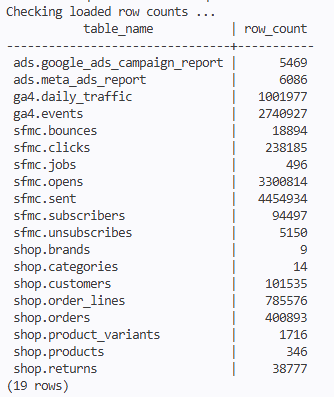
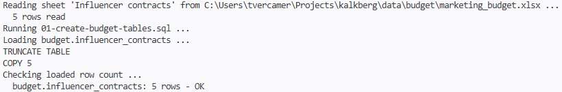

# Step 0: Setup

## What

This step covers the tools we use and how to rebuild the project from scratch, from an empty machine to a PostgreSQL database with all the raw data.

## Tools

| Tool | Used for | Version used |
| --- | --- | --- |
| Python | Generating the data and loading the budget workbook | 3.15 |
| PostgreSQL (incl. `psql`) | The database that holds the bronze, silver and gold layers | 19 |
| dbt (`dbt-postgres`) | Building the silver and gold layers | *added in step 3* |
| Power BI Desktop | Budget medallion, semantic model and report | *added in step 5* |

### Why these tools

- **PostgreSQL** is a full, free relational database that runs locally, so anyone can reproduce the project without a cloud subscription. Everything we do in it (schemas, views, SQL transformations) works the same way on a cloud data warehouse.
- **`psql` with `\copy`** is the fastest simple way to load large CSV files: about 20 million rows in a few minutes, with no extra Python database driver.
- **Python** is only used where SQL can't do the job: generating the fictional data, and reading an Excel sheet that `psql` can't open.

## How to reproduce the project

All commands below are for PowerShell and start from the project folder.

### 1. Generate the data and load it into PostgreSQL

```powershell
cd generator
python -m venv .venv
.venv\Scripts\Activate.ps1
pip install -r requirements.txt
python generate_data.py
```

The script asks for:

1. **The output folder** (an absolute path). The default is the `data` folder in the project, which is where the rest of the project expects it.
2. **Whether to load the data into PostgreSQL.** Answer *yes*, then enter host, port, database name (`kalkberg`), maintenance database (`postgres`), username and password.

> [!WARNING]
> Loading drops and recreates the whole database, including everything that was built on top of the raw data (the budget schema, and later the silver and gold layers). After regenerating, always repeat steps 2 and 3.

The generator ends by printing a row count per table. Compare it with the counts the generator printed while writing the files.



### 2. Land the influencer contracts

```powershell
cd ingestion
python -m venv .venv
.venv\Scripts\Activate.ps1
pip install -r requirements.txt
python load_influencer_contracts.py
```

The script asks for the path of `marketing_budget.xlsx` (default: `data/budget/marketing_budget.xlsx` in the project) and the database connection. It ends with a row-count check. See [step 1](01-bronze.md#2-the-influencer-contracts-sheet) for what it does and why.



### 3. Build silver and gold

*Added in step 3.*

## Running the tests

Both Python folders have unit tests that don't need a database:

```powershell
cd generator;  .venv\Scripts\python -m unittest; cd ..
cd ingestion;  .venv\Scripts\python -m unittest; cd ..
```

## Order of work after a regeneration

```
python generator/generate_data.py               # source systems + bronze (drops the database)
python ingestion/load_influencer_contracts.py   # budget.influencer_contracts
dbt build                                       # silver + gold (from step 3 onwards)
```
