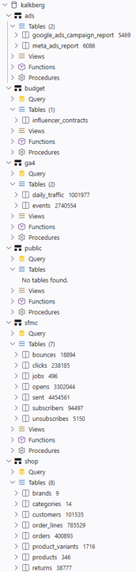
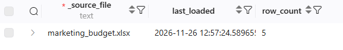

# Step 1: Bronze, landing the raw data in PostgreSQL

## What

The bronze layer holds an exact copy of what each source delivered, in the `kalkberg` database. Nothing is cleaned or interpreted yet. Bronze answers one question: *what did the source send us?*

| Schema | Source | Tables | Column types | Loaded by |
| --- | --- | --- | --- | --- |
| `shop` | Webshop database (operational, OLTP) | `categories`, `brands`, `products`, `product_variants`, `customers`, `orders`, `order_lines`, `returns` | Typed, with keys and constraints | Generator (`psql \copy`) |
| `ga4` | Google Analytics 4 exports | `events`, `daily_traffic` | All `text` | Generator (`psql \copy`) |
| `sfmc` | Salesforce Marketing Cloud data views | `subscribers`, `jobs`, `sent`, `opens`, `clicks`, `bounces`, `unsubscribes` | All `text` | Generator (`psql \copy`) |
| `ads` | Google Ads and Meta Ads report downloads | `google_ads_campaign_report`, `meta_ads_report` | All `text` | Generator (`psql \copy`) |
| `budget` | Sheet *Influencer contracts* of `marketing_budget.xlsx` | `influencer_contracts` | All `text` + load metadata | [`ingestion/load_influencer_contracts.py`](../ingestion/load_influencer_contracts.py) |

> [!NOTE]
> The rest of `marketing_budget.xlsx` (the four budget sheets and the targets) does **not** go into PostgreSQL. It is handled in Power Query in step 6.



> [!NOTE]
> The numbers next to the tables in this tree are PostgreSQL's estimated row counts (statistics kept for the query planner), so a few of them differ slightly from the exact counts in the generator's row check. Use `count(*)` (or `03-row-check.sql`) when you need exact numbers.

## How

### 1. The source exports

The generator writes the exports to `data/` and, if you ask it to, loads them with three SQL scripts in [`generator/sql/`](../generator/sql/):

| Script | What it does |
| --- | --- |
| `00-create-db.sql` | Drops and recreates the `kalkberg` database |
| `01-create-tables.sql` | Creates the four schemas and the raw tables |
| `02-load-raw-data.sql` | Loads every CSV file into its table with `\copy` |
| `03-row-check.sql` | Prints a row count per table |

`\copy` reads the files on the client side, so the files don't need to be on the database server, and loading 20 million rows takes minutes instead of hours.

### 2. The influencer contracts sheet

`psql` can read CSV files but not Excel workbooks. So for this one sheet we wrote a small loader, [`ingestion/load_influencer_contracts.py`](../ingestion/load_influencer_contracts.py), that turns the sheet into a CSV file and then loads it with the same `\copy` approach. It runs these steps:

1. **Read the sheet** with `openpyxl` and check that the header is exactly `Creator, Platform, Discount code, Start, End, Monthly fee (EUR), Remarks`. If someone in Marketing renames a column or adds one, the load stops with a clear message instead of silently loading the wrong data.
2. **Convert every cell to text.** Excel date cells become `YYYY-MM-DD`; everything else is written as it is (no trimming, no reformatting). Completely empty rows are skipped.
3. **Add load metadata** to every row: the file name (`_source_file`), the sheet (`_sheet_name`), the row number in the sheet (`_row_number`) and the load moment (`_loaded_at`).
4. **Create the table if it doesn't exist** ([`ingestion/sql/01-create-budget-tables.sql`](../ingestion/sql/01-create-budget-tables.sql)).
5. **Empty and reload the table in one transaction** (`TRUNCATE` + `\copy`, run with `psql --single-transaction`).
6. **Check the result:** the number of rows in the table must equal the number of rows read from the sheet.


## Why

### Why the raw schemas are the bronze layer

The generator already lands every export as-is: one table per file, every column as delivered. That is exactly what bronze should be. Copying ~1.3 GB into a separate `bronze` schema would only double the storage and add a step that can go wrong, without adding any information. See [decision 0002](decisions/0002-raw-schemas-are-bronze.md).

### Why most columns are `text`, but `shop` is typed

The schema mirrors the kind of source:

- **`ga4`, `sfmc`, `ads` and `budget` are file exports.** Files have no types. If we forced types at load time, one unexpected value (a date in another format, a number with a currency sign) would break the whole load, or worse, be silently converted. As text, every value lands, and converting is done in silver where we can see and decide what to do with values that don't fit.
- **`shop` is a copy of an operational database.** There the types, keys and constraints are part of what the source delivers, so we keep them. That doesn't mean the content is clean: a value can have the right type and still be wrong. Finding those cases is what step 2 is for.

### Why the influencer contracts go to PostgreSQL, and the rest of the workbook doesn't

The contracts sheet is not budget data: it's the only place that says **which discount code belongs to which creator, and when**. The SQL layers need that to assign orders to an influencer, to decide which channel brought in a new customer, and later for attribution. If that rule only lived in Power BI, every other tool would have to rebuild it. The budget and target sheets are planning numbers that are only compared with actuals in the report, so they can stay in Power Query. See [decision 0003](decisions/0003-influencer-contracts-in-postgres.md).

We read the workbook directly instead of keeping a CSV copy in the repository (a dbt seed). That way Marketing's workbook stays the single source of truth: a new contract shows up after the next load, and there is no second copy that can drift apart.

### Why the loader works the way it does

| Choice | Reason |
| --- | --- |
| A separate `ingestion/` folder, not part of `generator/` | The generator plays the source systems. Loading Marketing's workbook is the data team's job, and it would stay the same if the fake data were swapped for real data. |
| Check the header, stop on surprises | A hand-maintained sheet changes without warning. Failing loudly at load time is cheaper than finding wrong numbers in a report. |
| Everything as text, dates as ISO | Same rule as the other file exports. Dates are the one exception, because an Excel date cell holds a date, not text. ISO is the only notation that can't be misread (`01/04` is the 1st of April in Belgium, the 4th of January in the US). |
| No trimming, no case changes | Those are cleaning decisions and belong in silver, where they're visible and tested. |
| Load metadata columns | Every row can be traced back to the exact cell in the sheet, and you can see when the data was last refreshed. |
| `CREATE TABLE IF NOT EXISTS` instead of drop-and-create | The silver views built on this table in step 3 would be dropped together with it. A changed table structure is rare and is a conscious, manual action. |
| `TRUNCATE` + `\copy` in one transaction | The sheet has a handful of rows, so a full reload is simple and always correct. If the load fails halfway, the previous contents stay in place. |
| Reuse `psql` instead of a Python database driver | One way of loading for the whole project, and one dependency fewer. |

## What bronze deliberately does *not* do

- Fix types, formats, time zones or spellings
- Remove duplicates or test records
- Link sources to each other
- Apply business rules (such as "a discount code stays valid 14 days after the contract ends")

All of that happens in silver. First, in step 2, we profile the bronze data to find out exactly what needs fixing.

## Checking the bronze layer

After loading, these queries give a quick sanity check:

```sql
-- Row count per bronze table (the generator's own check)
\i generator/sql/03-row-check.sql

-- The influencer contracts, in sheet order
SELECT * FROM budget.influencer_contracts ORDER BY _row_number;

-- When was the workbook last loaded?
SELECT _source_file, max(_loaded_at) AS last_loaded, count(*) AS row_count
FROM budget.influencer_contracts
GROUP BY _source_file;
```



## Next step

Step 2: profiling the bronze data to find out what is wrong with it, before we decide how to clean it.
