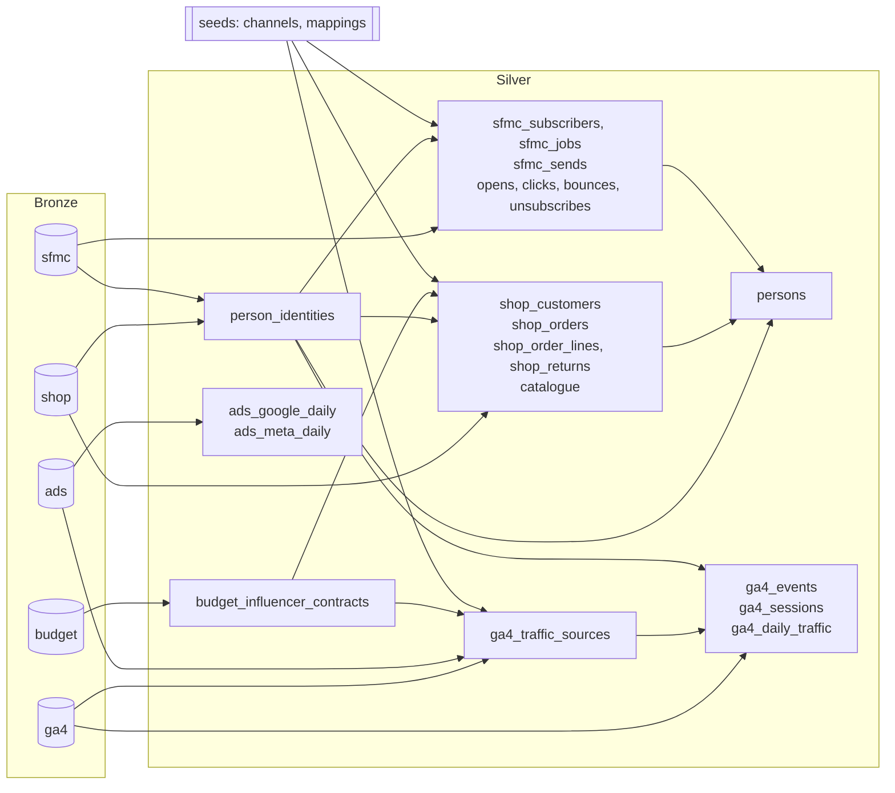

# Step 3: Silver, cleaning and connecting the data

## What

Silver turns the bronze data into clean, typed tables that can be linked to each other. It answers the question *what really happened?* Every transformation in silver points back to an issue in the [issue register](02-profiling.md#issue-register), and every issue with the decision **Fix** or **Flag** has at least one test that proves it was handled.

Silver lives in the `silver` schema of the `kalkberg` database and is built with dbt from the [`dbt/`](../dbt/) folder: 7 seeds, 24 models and 153 tests.

| Group | Models | What silver adds |
| --- | --- | --- |
| Webshop | `shop_customers`, `shop_orders`, `shop_order_lines`, `shop_returns`, `shop_products`, `shop_product_variants`, `shop_categories`, `shop_brands` | One time zone, ISO country codes, normalised discount codes, test data flagged, estimated purchase costs, a person key on every account and order |
| GA4 | `ga4_events`, `ga4_sessions`, `ga4_daily_traffic`, `ga4_traffic_sources` | Typed values, purchases counted once, one channel and campaign for every source/medium/campaign spelling, ISO country codes |
| Marketing Cloud | `sfmc_subscribers`, `sfmc_jobs`, `sfmc_sends`, `sfmc_opens`, `sfmc_clicks`, `sfmc_bounces`, `sfmc_unsubscribes` | Timestamps in UTC and Belgian time, a key per send, every open and click linked to its send, journeys named, typo and iCloud addresses flagged |
| Ad platforms | `ads_google_daily`, `ads_meta_daily` | No total rows, numbers converted, missing purchases kept as unknown |
| Budget | `budget_influencer_contracts` | Typed contracts, with the date until which the code counts |
| Integration | `person_identities`, `persons` | One person across shop accounts, guest orders and subscriber records |

The seeds are small mapping tables that *we* own:

| Seed | Content | Issue |
| --- | --- | --- |
| `channels` | The one channel list, with the matching channel name in the budget sheets | GA-01 |
| `map_traffic_source` | Every GA4 source/medium spelling → channel | GA-01 |
| `map_country` and `countries` | Every country notation → ISO code; which countries Kalkberg ships to | SH-01, GA-04 |
| `discount_codes` | The codes that are not influencer codes, with their type | SH-11, F3 |
| `email_domain_typos` | The five email domains that are a typo | MC-05 |
| `sfmc_journeys` | The five automated journey emails, their journey and their `utm_campaign` | E3, E4 |



> [!NOTE]
> Silver doesn't delete anything that might be real. Test data, traffic from countries without deliveries and untrustworthy opens are **flagged** with a column (`is_test`, `is_shipping_country`, `is_icloud_address`, ...), so gold can leave them out and the report can show them with a warning label. Silver only removes rows that are not data at all: the total rows in the Google Ads export (AD-01) and purchases that GA4 received twice (GA-05).

## How

### 1. The dbt project

```code
dbt/
  dbt_project.yml            --> project settings and the variables (migration date, time zone, grace period)
  profiles.yml               --> database connection, read from environment variables
  requirements.txt           --> the dbt version we use
  seeds/                     --> mapping tables we own (CSV), with their tests in seeds.yml
  macros/                    --> one macro per cleaning rule, so a rule is written once
  models/sources.yml         --> the bronze schemas as dbt sources
  models/silver/<group>/     --> one folder per source, plus integration/ for the person key
  models/silver/<group>/_<group>.yml  --> descriptions and tests per model
  tests/                     --> tests that compare sources with each other
```

Every model starts with a comment that lists the issues it handles, for example in `shop_orders.sql`:

```sql
{#-
    Orders, one row per order.
    SH-01  shipping country -> ISO code
    SH-02  created_at -> UTC and Belgian local time; order_date is the Belgian date
    ...
-#}
```

### 2. Building silver

dbt runs in its own virtual environment in the `dbt` folder (see [step 0](00-setup.md#3-build-silver-and-gold)). With the connection set in the `DBT_PG_*` environment variables:

```powershell
cd dbt
.venv\Scripts\Activate.ps1
dbt build
```

`dbt build` loads the seeds, builds every model as a table and runs every test, in dependency order. A model's tests run right after it is built, and if a test fails, the models that depend on it are skipped. The whole run takes about 4,5 minutes, most of it spent on the large Marketing Cloud and GA4 tables.

> SCREENSHOT PLACEHOLDER: terminal output of `dbt build`, ending with `Done. PASS=184 WARN=0 ERROR=0 SKIP=0`.

To browse the models, their columns and the lineage in a browser:

```powershell
dbt docs generate
dbt docs serve
```

> SCREENSHOT PLACEHOLDER: the lineage graph in `dbt docs serve`, from the bronze sources through `person_identities` to `shop_orders`.

### 3. From issue to model to test

| Issue | Decision | Where in silver | Proven by |
| --- | --- | --- | --- |
| SH-01 Countries in 28 notations | Fix | `map_country`; `shop_customers.country_code`, `shop_orders.shipping_country_code` | `accepted_values` BE, NL, FR, DE, LU |
| SH-02 Time zone changed at the migration | Fix | Macro `shop_timestamp_to_utc`; `*_utc`, `*_local`, `order_date` | `assert_shop_time_zone_matches_ga4`, `assert_shop_platform_matches_migration_date`, `assert_shop_one_clock_jump_per_table` |
| SH-03 Return times carry no information | Accept | `shop_returns` keeps only `requested_date` and `received_date` | – |
| SH-04 Two order number formats | Accept | `shop_orders.platform` | `unique` on `order_number` |
| SH-05 Test data | Exclude (in gold) | Macros `is_test_email`, `is_test_name`; `is_test` on accounts, orders and persons | `assert_test_orders_excluded_consistently` |
| SH-06 Duplicate accounts | Fix | `person_identities`, `persons`, `person_key` on accounts | `not_null` and `relationships` on `person_key` |
| SH-07 Guest orders of known customers | Fix | `shop_orders.person_key` through the guest email | `not_null` on `shop_orders.person_key` |
| SH-08 Names written inconsistently | Fix | Names trimmed in `shop_customers` | – (names don't go to gold) |
| SH-09 Phone numbers | Accept | Not carried to silver | – |
| SH-10 Placeholder birth dates | Fix | Macro `clean_birth_date`; `birth_date_issue` says why it's empty | `expression_is_true`, `accepted_values` |
| SH-11 Discount codes in several notations | Fix | Macro `normalise_code`; `discount_code_type`, `influencer_creator` | `accepted_values` on `discount_code_type` |
| SH-12 Rounding differences | Accept | `shop_orders.total_rounding_difference` | `abs(total_rounding_difference) <= 0.05` |
| SH-13 Duplicate product names | Fix | Trimmed names, `product_name_key`, `has_duplicate_name` | `expression_is_true` on trimmed names |
| SH-14 Variants without purchase cost | Fix | `unit_cost` with median of the other sizes, `is_unit_cost_estimated` | – |
| AD-01 Total rows in Google Ads | Exclude | `ads_google_daily` keeps only rows with a date | `unique_combination_of_columns` on day + campaign |
| AD-02 US number notation | Fix | Macro `us_number` | `not_null` on `cost` |
| AD-03 Meta purchases missing | Flag | `platform_conversions` stays empty, `is_purchases_missing` | – |
| AD-04 Ad set names not unique | Accept | `ads_meta_daily.ad_set_key` | `unique_combination_of_columns` on day + ad set key |
| GA-01 Source spellings | Fix | `map_traffic_source`, `channels`, `ga4_traffic_sources` | `not_null` and `relationships` on `channel_key` |
| GA-02 Two Meta campaign styles | Fix | Macro `name_key`, matched against the Meta report | `campaign_issue` only allows *template not filled* |
| GA-03 Unfilled campaign template | Flag | Campaign *Unknown (template not filled)*, `campaign_issue` | idem |
| GA-04 US and UK traffic | Exclude (in gold) | `country_code`, `is_shipping_country` | `not_null` on `country_code` |
| GA-05 Purchases sent twice | Fix | `ga4_events` keeps the first purchase per transaction | `assert_ga4_one_purchase_per_transaction` |
| GA-06 GA4 sees about 82% of orders | Flag | – (warning label in the report) | – |
| GA-07 Purchase value excludes shipping | Accept | `shop_orders.order_total_excl_shipping` | – |
| GA-08 The event export isn't all traffic | Accept | `ga4_sessions` for journeys, `ga4_daily_traffic` for traffic | – |
| MC-01 US timestamp notation | Fix | Macro `sfmc_parse_timestamp` | `not_null` on the timestamps |
| MC-02 Fixed UTC−6 | Fix | Macro `sfmc_timestamp_to_utc` | `assert_sfmc_time_zone_matches_ga4` |
| MC-03 More records than people | Fix | `sfmc_subscribers.person_key`, `persons.is_reachable` | `relationships` on `person_key` |
| MC-04 Three kinds of subscriber key | Accept | `subscriber_key_type`; the key is never used to match | `accepted_values` |
| MC-05 Typos in email domains | Flag | `email_domain_typos`; `has_email_domain_typo` | `unique` on the seed |
| MC-06 Machine opens | Flag | `is_icloud_address` on subscribers, sends, opens and clicks | – |
| MC-07 Repeated journey sends | Accept | `send_key`; macro `sfmc_link_to_send` | `unique` on `send_key`, `not_null` and `relationships` on every event's `send_key`, `time_since_send >= 0` |
| X-01 Platforms tell different stories | Flag | Platform numbers are called `platform_conversions` | – |
| X-02 Subscribers without opt-in | Fix + Flag | Linked by person; `persons.has_opt_in_mismatch` | – |

### 4. Conventions in silver

| Convention | Meaning |
| --- | --- |
| `<moment>_utc` and `<moment>_local` | Every timestamp twice, both as `timestamp` without time zone: in UTC and as Belgian clock time. Daily and monthly reports use the Belgian date (`order_date`, `sent_date`, ...). |
| `_normalised` | A value in the one notation used for matching (lowercase email, ...) |
| `is_...` / `has_...` | A flag. Flags never contain `NULL`. |
| `person_key` | The person behind an account, a guest order, a subscriber record or a logged-in GA4 session. A hash, so it carries no personal data. |
| `channel_key` | A key from the `channels` seed. Every source uses the same list. |
| `platform_...` | A number as the ad platform reports it, by its own rules. Show it next to the shop's numbers, never add it up with them (X-01). |
| `..._reported` | A number kept only as evidence, not to be used (the purchases in the GA4 traffic report, GA-05) |

### 5. What building silver taught us

The tests did their job straight away. The first version of SH-02 changed the time zone based on the clock time: everything before 02/09/2024 was treated as Belgian time. The test `assert_shop_platform_matches_migration_date` failed on 7 orders. The new platform went live at midnight Belgian time, which is 22:00 UTC. So on the evening of 01/09/2024, the old platform was still writing Belgian times up to 23:59, while the new platform was already writing UTC times from 22:00. In those two hours, the clock time alone can't tell which time zone a timestamp is in.

The fix decides the platform per record instead:

- **Orders**: the order number says which platform the order was placed on (SH-04).
- **Accounts**: `customer_id` follows the order of creation, and at the migration the clock jumps back exactly once, from Belgian time to UTC. The first account after that jump is the first account of the new platform. A test checks that there is exactly one such jump, so the rule can't silently go wrong.

After the fix, 99,998% of the orders that GA4 recorded are within 10 minutes of the GA4 purchase, and the evening peak in orders is at 20:00–21:00 Belgian time on both platforms.

The person key gives a first picture of the customer base:

| | People |
| --- | --- |
| All people (accounts, guest buyers and subscribers) | 144.294 |
| People with a shop account | 100.333 |
| of whom with 2 accounts | 1.202 |
| People who only ordered as a guest, never subscribed | 13.961 |
| Subscribers (people, not records) | 89.286 |
| Subscribers who are also a shop customer | 59.286 |
| Subscribers without opt-in in the shop (X-02) | 3.171 |
| Test people (SH-05) | 35 |

7.077 of the 24.000 guest orders belong to someone who also has an account (SH-07). The profiling counted 3.404 *accounts* with an opt-in mismatch; silver counts *people*, which is lower because a person with two accounts is counted once, and a person counts as opted in when any of their accounts is.

## Why

### Why dbt

| Choice | Reason |
| --- | --- |
| dbt for every transformation | The SQL stays plain SQL, but dbt adds what a project of this size needs: the order of building, tests on every model, documentation next to the code, and a lineage graph that shows where a number comes from. |
| One macro per cleaning rule | A rule such as "add 6 hours to a Marketing Cloud timestamp" is used in seven models. Written once, it can't be applied differently in two places. The macro carries the issue ID, so the rule can be traced back to its evidence. |
| Variables for the migration date, the time zone and the 14-day grace period | Business facts belong in one visible place, not hidden in a `WHERE` clause. |
| Connection from environment variables | No password in the repository, and every developer can point the same project to their own database. |

### Why tables, in one `silver` schema

| Choice | Reason |
| --- | --- |
| Every model is a table, not a view | Silver is read by gold and, for checks, by people. Several models (the send linking, the sessions) take a minute to compute. As tables, that work is done once per build. |
| One schema per layer, with the source as prefix (`shop_`, `ga4_`, ...) | The layer is visible in the schema, the source in the name. dbt's default would create `silver_silver`; the macro `generate_schema_name` uses the configured name as-is. |
| Seeds in the `silver` schema | They are part of the cleaning rules, read by silver models only. |
| A full rebuild on every run, no incremental models | The data is rebuilt from scratch after every regeneration anyway, and a full build takes minutes. Incremental logic would add complexity without any gain here. |

### Why flag instead of delete

Silver keeps every real row and marks what is doubtful. Whether test orders or US traffic are left out is a reporting decision, taken once in gold. If silver deleted them, nobody could later check *how many* were left out, and the warning labels in the report (D6) would have no numbers behind them. The two exceptions, the Google Ads total rows and the GA4 purchases sent twice, are not data: keeping them would only invite double counting.

### Why the person key works the way it does

Matching people is the most consequential rule in silver: new customers, CAC, lifetime value, retention and the subscriber-customer link all depend on it. See [decision 0004](decisions/0004-person-key.md) for the options we considered. In short:

- **Email first, then name + birth date + postal code**, applied together (connected components), because profiling showed both kinds of duplicates (SH-06).
- **The email address, not the subscriber key, links Marketing Cloud to the shop**, because the key is only sometimes a customer number (MC-04).
- **Placeholder birth dates are excluded from matching** (SH-10), otherwise everyone born on 01/01/1900 with the same name and postal code would become one person.
- **A hash as key**, so gold and the report can count people without carrying email addresses.

### Why the cross-source tests

A time zone can't be seen in one timestamp, so it can't be tested on one table either. The tests `assert_shop_time_zone_matches_ga4` and `assert_sfmc_time_zone_matches_ga4` compare the same moment in two systems, as the profiling did, but now on the *cleaned* data and on every build. They allow for a margin (99% within 10 minutes, 90% within 5 minutes) because a GA4 purchase or session is not always registered at exactly the same second.

### Why some issues have no test

A test needs a rule that the data must obey. For SH-14 (estimated cost) or MC-06 (machine opens), silver adds information but there is nothing that must be true afterwards. Those are covered by the column descriptions and, from step 4 on, by the warning labels.

## Checking the silver layer

```sql
-- Row count per silver table
SELECT relname AS table_name, n_live_tup AS row_count
FROM pg_stat_user_tables
WHERE schemaname = 'silver'
ORDER BY relname;

-- Orders per platform and hour of day, in Belgian time (SH-02)
SELECT platform, extract(hour FROM created_at_local) AS hour, count(*) AS orders
FROM silver.shop_orders
WHERE NOT is_test
GROUP BY 1, 2
ORDER BY 1, 2;

-- Sessions per channel (GA-01)
SELECT channel_key, count(*) AS sessions, sum(purchases) AS purchases
FROM silver.ga4_sessions
GROUP BY channel_key
ORDER BY sessions DESC;
```

## Next step

Step 4: the gold layer, a star schema with facts and dimensions built on silver.
