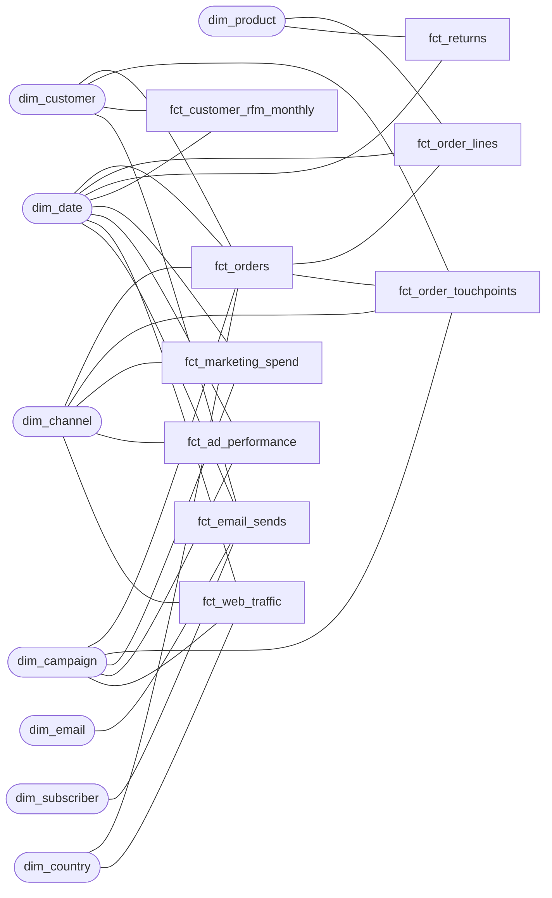

# Step 4: Gold, the star schema

## What

Gold turns the clean silver tables into a model for reporting: a **star schema** of facts (things that happened, with numbers) and dimensions (the things you filter and group by). It answers the question *how do we want to look at what happened?* Every business rule that a report needs (what is revenue, who is a new customer, which channel gets an order) is decided here, once, so that every report uses the same definition.

Gold lives in the `gold` schema and is built by the same dbt project as silver: 17 models, two extra seeds and 83 tests. Test data is left out of gold (SH-05). Power BI only reads from gold (step 5).

### The tables

| Table | Grain (one row per …) | Rows | Answers |
| --- | --- | --- | --- |
| **Facts** | | | |
| `fct_orders` | order | 400.792 | Revenue, orders, AOV, new customers, discounts, refunds, margin, order channel (M1–M5, F2–F4, C8, C9) |
| `fct_order_lines` | order line | 785.475 | Products, categories, sizes, returns, margin per product (C4–C7, F2, F5, F6) |
| `fct_returns` | return request | 38.777 | Return reasons and refund times (C5, F4) |
| `fct_order_touchpoints` | order × GA4 session in its journey | 570.728 | Journeys and the four attribution models (PM3, PM4) |
| `fct_customer_rfm_monthly` | customer × month | 2.094.561 | RFM segments and how customers move between them (C3) |
| `fct_marketing_spend` | day × channel × campaign | 12.023 | Actual marketing cost (M3, M4, F1) |
| `fct_ad_performance` | day × platform × campaign × ad set | 11.551 | Cost, clicks, CPC, platform conversions (PM1, PM2, PM5, PM6) |
| `fct_web_traffic` | day × channel × campaign × device × country | 467.026 | Sessions and conversion rates (PM10, D1) |
| `fct_email_sends` | email send | 4.454.934 | Delivery, open, click and unsubscribe rates, email revenue (E2–E6, E8, E9) |
| **Dimensions** | | | |
| `dim_date` | day, 2023–2026 | 1.461 | Calendar, promotion periods (M7, C7) |
| `dim_customer` | person | 144.259 | Customers and subscribers, acquisition channel, cohort, lifetime value (M5, M6, C1, C2, E7) |
| `dim_product` | variant | 1.716 | Product, brand, category, size |
| `dim_channel` | channel | 10 | The one channel list, shared with the budget |
| `dim_campaign` | channel × campaign | 147 | Campaigns of every channel under one key |
| `dim_country` | country | 8 | Countries, and whether Kalkberg ships there |
| `dim_email` | email job | 496 | Newsletter, campaign or journey email, language |
| `dim_subscriber` | subscriber record | 94.497 | List growth, unsubscribes (E1) |



The budget and the targets are not in gold: they go through their own medallion in Power Query (step 6, [decision 0001](decisions/0001-medallion-in-two-tools.md)) and meet gold in the semantic model through `dim_date` and `dim_channel` (`dim_channel.budget_channel` holds the channel name as the budget sheets write it).

## How

### 1. Building gold

Gold is part of the same dbt project, so the same command builds both layers:

```powershell
cd dbt
.venv\Scripts\Activate.ps1
dbt build                       # silver and gold
dbt build --select models/gold  # only gold, when silver is up to date
```

The full build (9 seeds, 41 models, 236 tests) takes under 4 minutes.

> SCREENSHOT PLACEHOLDER: terminal output of `dbt build`, ending with `Done. PASS=286 WARN=0 ERROR=0 SKIP=0`.

### 2. The business rules

These definitions are the heart of gold. They are written in the model comments, and the report uses them as they are.

#### Revenue and margin

| Amount | Definition |
| --- | --- |
| `order_total` | What the customer paid, incl. VAT and shipping. The shop's own total (SH-12). |
| `net_revenue` | `order_total` minus refunds. |
| `gift_card_amount` | The part of the order that is a gift card. Not revenue until the card is used (F6); reports can leave it out. |
| `*_excl_vat` | The same amounts without VAT, using the VAT rate of the destination country (seed `vat_rates`). |
| `gross_margin` | Revenue excl. VAT, minus refunds excl. VAT, minus the purchase cost of the items the customer kept, plus the shipping fee excl. VAT. Gift cards have no margin. |
| Cancelled orders | Kept in `fct_orders` with `is_cancelled`, but not counted as orders or revenue. |

#### Customers

| Concept | Definition |
| --- | --- |
| Customer | A person (decision 0004) with at least one order that was not cancelled. |
| New customer | The person's first order that was not cancelled (`is_new_customer_order`). 112.662 in the data. |
| Cohort | The month of the first order. |
| Acquisition channel | The channel of the first order (see below). Basis for CAC and lifetime value per channel. |
| Lifetime value | Net revenue (and margin) in the first 12 and 24 months after the first order. Only comparable for customers whose first order is at least 12 or 24 months before the end of the data (`is_clv_12m_complete`, `is_clv_24m_complete`). |

#### The channel of an order

Every order gets one channel, `order_channel_key`, in this order of priority ([decision 0005](decisions/0005-order-channel-and-attribution.md)):

1. **The discount code**: an influencer code or the affiliate code. The partner is paid for that order, so it is their order.
2. **The last non-direct GA4 session** before the order (the standard "last non-direct click").
3. **Direct**, when every session in the journey was direct.
4. **Unattributed**, when no source can say anything: the order isn't in GA4 (no cookie consent, GA-06) and has no partner code. That is 16,0% of the orders.

The code-based and click-based views are also kept separately (`code_channel_key`, `last_click_channel_key`), so PM7 can compare tracked links with discount codes.

#### Journeys and attribution

`fct_order_touchpoints` holds the journey of every order: the GA4 sessions of the same person (logged in) or the same browser that started at most 30 days before the order and after the person's previous order. Each touchpoint has a weight per attribution model:

| Model | Weight |
| --- | --- |
| First click | 100% to the first touchpoint |
| Last click | 100% to the last touchpoint |
| Linear | Equal shares |
| Position based | 40% first, 40% last, 20% shared by the ones in between (50/50 with two touchpoints) |

An order without sessions gets one touchpoint *no session* with its own channel. That way the weights of every order add up to 1 in every model, and attributed revenue always adds up to total revenue (tested).

> [!WARNING]
> GA4 only sees visitors who accept cookies (GA-06), and the event export only holds sessions with shopping activity (GA-08). A journey is therefore a lower bound: it can only contain sessions GA4 recorded. Channels that drive visits without shopping (for example early research) are undervalued by every model.

#### Marketing cost

| Channel | Actual cost | Source |
| --- | --- | --- |
| Paid search, paid social | Daily cost per campaign | Google Ads and Meta reports |
| Influencers | Monthly fee per contract, spread over the days the contract runs | Contracts sheet |
| Affiliates | **Estimate**: 8% of the affiliate orders' revenue excl. VAT and shipping | `fct_orders` × commission rate from *context.md* |
| Email, SEO | No actual cost in any source | Budget only (step 6) |

#### Email revenue

An order belongs to the email send in which the customer last clicked, when that click was at most 72 hours before the order. Each order belongs to at most one send. This is independent of GA4, so it also works for customers who refused cookies. 11,5% of the orders are linked to an email this way.

#### RFM segments

`fct_customer_rfm_monthly` scores every customer at the end of every month, from their first order on:

| Score | 5 | 4 | 3 | 2 | 1 |
| --- | --- | --- | --- | --- | --- |
| Recency (days since last order) | ≤ 30 | ≤ 90 | ≤ 180 | ≤ 365 | > 365 |
| Frequency (orders so far) | ≥ 6 | 4–5 | 3 | 2 | 1 |
| Monetary (net revenue so far) | ≥ €550 | ≥ €240 | ≥ €130 | ≥ €70 | < €70 |

The monetary thresholds are the rounded quintiles of the revenue per customer over the whole data period (€68,99, €128,81, €240,46 and €550,70). The segments combine recency and frequency:

| Segment | Recency | Frequency |
| --- | --- | --- |
| Champions | 4–5 | 4–5 |
| Loyal customers | 3–5 | 3–5 |
| New customers | 4–5 | 1 |
| Promising | 4–5 | 2 |
| Need attention | 3 | 1–2 |
| At risk | 2 | 3–5 |
| Hibernating | 2 | 1–2 |
| Lost | 1 | any |

`previous_segment` shows the segment one month earlier, so movements between segments can be counted directly.

#### Promotion periods

The automatic promotions are not written down in any source. They show up clearly in the data as runs of days on which orders *without* a discount code got a line discount: almost every order in the Black Friday weeks, about a quarter to a third during the January and summer sales, and crash pads and ropes from 20/03 to 05/04 (the spring promotion, 2025 and 2026). These periods are in the seed `promotion_periods` and in `dim_date.promotion_name`.

### 3. Assumptions to confirm with the business

| Assumption | Why it matters | Where |
| --- | --- | --- |
| VAT rates per destination country were constant over the period, books at the reduced rate, gift cards without VAT | Revenue excl. VAT and margin | Seed `vat_rates` |
| Purchase costs are today's costs: the shop keeps no history | Margin trends over time, the effect of the yearly price increase (F5) | `dim_product.current_unit_cost` |
| Refunded items go back into stock | Cost of returned items is not a loss | `fct_order_lines.cost_amount_after_returns` |
| Affiliate commission is 8% of revenue excl. VAT and shipping, also for orders that were later refunded | Affiliate cost and profitability (PM8) | `fct_marketing_spend` |
| An influencer's fee is paid for every month of the contract, pro rata for partial months | Influencer cost and payback (PM7) | `fct_marketing_spend` |
| Shipping costs are not in any source | Gross margin includes the shipping fee charged, not the shipping cost | `fct_orders.gross_margin` |

### 4. Tests

Besides the usual key and relationship tests on every fact and dimension, five tests check that gold tells the same story as silver:

| Test | What it checks |
| --- | --- |
| `assert_gold_revenue_reconciles_with_silver` | Per month, gold has exactly the same orders and revenue as the real orders in silver, and the order lines add up to the order totals |
| `assert_attribution_weights_add_up_to_one` | Every order has a journey, and its weights add up to 1 in every model |
| `assert_marketing_spend_reconciles_with_platforms` | The platform cost in `fct_marketing_spend` equals the ad reports |
| `assert_new_customers_match_first_orders` | Every customer has exactly one first order, on their first order date |
| `assert_web_traffic_purchases_match_ga4` | The traffic fact holds every GA4 purchase exactly once |

## Why

### Why a star schema

| Choice | Reason |
| --- | --- |
| Facts and dimensions instead of wide tables | Power BI works best with a star schema: filters flow from dimensions to facts, measures stay simple, and the model stays small because descriptive text is stored once in a dimension. |
| One fact per process (orders, sends, traffic, spend, ...) | Each process has its own grain. Mixing them (for example traffic and orders in one table) would force one of them to the wrong level of detail. |
| Shared dimensions (`dim_date`, `dim_channel`, `dim_campaign`, `dim_customer`) | That is what makes cross-process questions possible: cost from `fct_marketing_spend` and new customers from `fct_orders` meet in `dim_channel`, which is CAC per channel. |
| Text keys for campaigns (`paid_social \| BF 2025 - Prospecting`) | Readable in every table and every query, and the same in every source after the cleaning in silver. 147 campaigns don't need a surrogate integer. |

### Why decide business rules in gold, not in DAX

The channel of an order, a new customer, lifetime value and the RFM segment all need to look at several rows at once (all orders of a person, all sessions before an order). In SQL these are window functions that run once per build and can be tested. In DAX they would be recalculated on every click, would be hard to test, and would be invisible to any other tool. DAX is left with what it does best: adding up, dividing and comparing periods.

### Why the rules are what they are

| Choice | Reason |
| --- | --- |
| Revenue incl. VAT as the headline number, excl. VAT for margin | Management and marketing think in what the customer paid; margin can only be calculated on amounts without VAT, because costs have no VAT. |
| Fixed RFM thresholds instead of quintiles per month | With quintiles per month, a customer can change segment without changing behaviour, simply because others did. Fixed thresholds make movements between segments meaningful. |
| A *no session* touchpoint for orders without sessions | Without it, the attribution models would only add up to the 82% of revenue that GA4 sees, and every channel's share would look bigger than it is. With it, the untracked part stays visible as *unattributed*. |
| Email revenue through clicks, not GA4 | Marketing Cloud knows who clicked, also when GA4 doesn't know the visitor. That makes email revenue the most complete attribution in the data, and independent of cookie consent. |
| The affiliate commission as an estimate in the same fact as real costs | CAC and ROAS per channel need the affiliate cost next to the others. `is_estimated` and `cost_source` keep it recognisable. |
| An `ANALYZE` after every model | A freshly created table has no statistics yet. Without them PostgreSQL once chose a plan for `fct_orders` that ran for more than 10 minutes instead of 10 seconds. |

## Checking the gold layer

```sql
-- Orders, revenue and new customers per month
SELECT d.year_month,
       count(*) FILTER (WHERE NOT o.is_cancelled)             AS orders,
       sum(o.order_total) FILTER (WHERE NOT o.is_cancelled)   AS revenue,
       count(*) FILTER (WHERE o.is_new_customer_order)        AS new_customers
FROM gold.fct_orders AS o
JOIN gold.dim_date AS d ON d.date = o.order_date
GROUP BY d.year_month
ORDER BY d.year_month;

-- Revenue per channel under the four attribution models
SELECT t.channel_key,
       round(sum(t.weight_first_click    * o.order_total)) AS first_click,
       round(sum(t.weight_last_click     * o.order_total)) AS last_click,
       round(sum(t.weight_linear         * o.order_total)) AS linear,
       round(sum(t.weight_position_based * o.order_total)) AS position_based
FROM gold.fct_order_touchpoints AS t
JOIN gold.fct_orders AS o USING (order_id)
GROUP BY t.channel_key
ORDER BY last_click DESC;

-- Customers per RFM segment at the end of the data
SELECT segment, count(*) AS customers
FROM gold.fct_customer_rfm_monthly
WHERE snapshot_date = (SELECT max(snapshot_date) FROM gold.fct_customer_rfm_monthly)
GROUP BY segment
ORDER BY min(segment_sort_order);
```

## Next step

Step 5: connecting Power BI to the gold layer.
