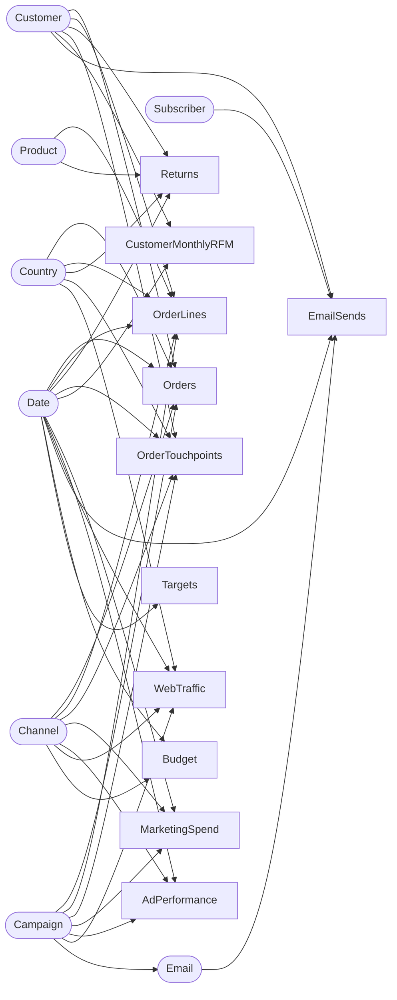

# Step 7: Semantic model and DAX measures

> [!NOTE]
> This step is in progress. This document describes the relationships and the display locale. The measures will follow.

## What

Step 5 and step 6 loaded the tables. This step turns them into a model: the relationships between facts and dimensions, the formats every value is shown in, and the DAX measures that answer the questions in [context.md](../context.md).

| Part | Status |
| --- | --- |
| [Relationships](#1-relationships) | Designed |
| [Display locale: English labels, Belgian formats](#2-display-locale-english-labels-belgian-formats) | Done |
| Measures | Planned |

## How

### 1. Relationships

All relationships follow the same rules:

- **Many-to-one**, from a fact (`*`) to a dimension (`1`).
- **Single direction**: the dimension filters the fact, never the other way around.
- **Facts only connect to dimensions**, never to another fact. Dimensions don't connect to each other either, with one exception (`Email` → `Campaign`).
- Where a fact can join to the same dimension in more than one way, one relationship is active and the others are **inactive**. A measure switches one on with `USERELATIONSHIP` when it needs that view.

#### Active relationships

Each cell names the fact column that points to the dimension. The dimension's key is shown in the header.

| Table | `Date[date]` | `Customer[person_key]` | `Channel[channel_key]` | `Campaign[campaign_key]` | `Product[variant_id]` | `Country[country_code]` |
| --- | --- | --- | --- | --- | --- | --- |
| `Orders` | `order_date` | `person_key` | `order_channel_key` | `order_campaign_key` | | `shipping_country_code` |
| `OrderLines` | `order_date` | `person_key` | `order_channel_key` | `order_campaign_key` | `variant_id` | `shipping_country_code` |
| `Returns` | `order_date` | `person_key` | | | `variant_id` | `shipping_country_code` |
| `OrderTouchpoints` | `order_date` | `person_key` | `channel_key` | `campaign_key` | | `country_code` |
| `CustomerMonthlyRFM` | `month_start` | `person_key` | | | | |
| `MarketingSpend` | `spend_date` | | `channel_key` | `campaign_key` | | |
| `AdPerformance` | `report_date` | | `channel_key` | `campaign_key` | | |
| `WebTraffic` | `traffic_date` | | `channel_key` | `campaign_key` | | `country_code` |
| `EmailSends` | `sent_date` | `person_key` | | | | |
| `Budget` | `month_start` | | `channel_key` | | | |
| `Targets` | `month_start` | | | | | |

Three more active relationships aren't in this table:

| From | To |
| --- | --- |
| `EmailSends[job_id]` | `Email[job_id]` |
| `EmailSends[subscriber_id]` | `Subscriber[subscriber_id]` |
| `Email[campaign_key]` | `Campaign[campaign_key]` |

That makes 40 active relationships.

The arrows show the direction the filter flows: from the dimension to the fact.

#### Inactive relationships

| From | To | Used for |
| --- | --- | --- |
| `Orders[code_channel_key]` | `Channel[channel_key]` | Influencers: orders by discount code, compared with tracked links (PM7) |
| `Orders[last_click_channel_key]` | `Channel[channel_key]` | The same comparison, the click-based view (PM7) |
| `OrderTouchpoints[touchpoint_date]` | `Date[date]` | Touchpoints in the month of the session instead of the order (PM4) |
| `Returns[requested_date]` | `Date[date]` | Returns per month in which they were requested |
| `Returns[received_date]` | `Date[date]` | Refunds per month (F4): the refund follows the receipt of the parcel |
| `Subscriber[joined_date]` | `Date[date]` | List growth (E1) |
| `Subscriber[unsubscribed_date]` | `Date[date]` | Unsubscribes per month (E1) |
| `Customer[acquisition_channel_key]` | `Channel[channel_key]` | Lifetime value per acquisition channel (M6) |

#### Links that are left out on purpose

| Link | Why not |
| --- | --- |
| `Orders` → `OrderLines`, `Orders` → `OrderTouchpoints`, `OrderLines` → `Returns` | Facts don't filter each other ([see below](#why-no-relationships-between-facts)). The facts carry the order columns they need instead. |
| `Campaign` → `Channel` | Channel would filter `MarketingSpend` both directly and through `Campaign`. `Campaign[channel_key]` stays available as a column. |
| `Customer` → `Country`, `Subscriber` → `Customer` | Same: a second path from `Country` to `Orders`, or from `Customer` to `EmailSends`. |
| `Customer[first_order_date]`, `Product[launched_date]`, `Campaign[first_date]`, `Email[delivered_date]` → `Date` | Date would filter the facts both directly and through the dimension. Cohorts use `Customer[cohort_month]`, and new customers are counted in `Orders` with `is_new_customer_order`. |

#### Columns added to gold for this

Without relationships between facts, two facts need columns they used to get from `Orders` ([step 4](04-gold.md#the-tables)):

| Table | Added | Needed for |
| --- | --- | --- |
| `fct_order_lines` | `order_channel_key`, `order_campaign_key` | Margin per category *and* channel (F2) |
| `fct_order_touchpoints` | `order_date`, `order_net_revenue`, `order_gross_margin` | Attributed revenue per attribution model (PM3), shown in the month of the order |

`fct_orders` is built from the order lines and the touchpoints, so these two facts can't read from it directly: that would be a loop. Their logic moved to two intermediate models (`int_order_lines`, `int_order_touchpoints`) in the schema `gold_intermediate`. `fct_orders` is built from those, and the two gold facts are the intermediate model plus the columns of their order. A new test, `assert_attributed_revenue_adds_up_to_revenue`, checks that the revenue attributed to the touchpoints adds up to the revenue of the orders in every month and every model.

### 2. Display locale: English labels, Belgian formats

The report shows English labels with Belgian dates and numbers: `31/03/2026` and `1.234,56` ([conventions](README.md#conventions-in-these-documents)). Three settings are involved, and only one of them controls the display:

| Setting | Where | Value | What it does |
| --- | --- | --- | --- |
| Locale for import | **File > Options and settings > Options > Current file > Regional settings** | Dutch (Belgium) | How Power Query *reads* text as dates and numbers ([step 5](05-powerbi-connection.md#3-file-settings-once-for-this-file)). |
| Model language | `culture` in [`model.tmdl`](../powerbi/kalkberg.SemanticModel/definition/model.tmdl) | `en-US` | How text is sorted and compared. It doesn't affect how values are shown, and it can't be changed once the model exists. |
| **Default format string locale for dates and numbers** | **File > Options and settings > Options > Current file > Regional settings** | **Dutch (Belgium)** | How dates and numbers are *shown* in visuals, whatever the viewer's browser or Windows settings are. Stored in the report as `settings.locale` in [`report.json`](../powerbi/kalkberg.Report/definition/report.json), so it applies in Power BI Desktop and in the service. |

The format string locale offers no *English (Belgium)*. English (United Kingdom) has the right dates but writes numbers as `1,234.56`, so the report uses **Dutch (Belgium)**: exactly the Belgian dates and numbers. That locale writes month and weekday names in Dutch (`maart`, `ma`), so the labels stay English because of how the model is built:

- **Date columns** use `Short Date` (`31/03/2026`), and date-time columns use `General Date` (`31/03/2026 14:05:00`). Both follow the locale and contain no names. Formats that write out names, such as `Long Date` or `mmmm yyyy`, are not used.
- **Month and weekday labels** come from the text columns of `Date` (`month_name`, `month_short`, `year_month`, `weekday_name`). dbt writes them in English, so they don't depend on the locale.
- **Measures** will use format strings such as `#,0` and `#,0.00`. In a format string the `,` and `.` are placeholders: Dutch (Belgium) shows them as `1.234,56`.

> [!NOTE]
> Without the format string locale, Power BI Desktop takes the formatting from the Windows region settings, and the service takes it from the viewer's browser language. The same report would then show `03/31/2026` to one person and `31/03/2026` to another.

## Why

### Why no relationships between facts

The gold diagram in [step 4](04-gold.md#the-tables) links `fct_orders` to its lines and touchpoints, because that's how the tables relate in SQL. In Power BI, the same link creates a second filter path. `Date` would reach `OrderLines` both directly and through `Orders`, and Power BI only allows one active path between two tables. The choice is between connecting `OrderLines` only through `Orders`, or connecting it straight to the dimensions.

We connect every fact straight to the dimensions:

- Every fact works on its own: a measure on `OrderLines` only depends on `OrderLines` and the dimensions.
- Filters behave the same in every fact. A filter on `Channel` reaches `OrderLines` through `order_channel_key`, the same rule `Orders` uses.
- The columns that a fact needs from its order are added in gold, where they are built once and tested, rather than looked up row by row in DAX.

### Why the touchpoints are dated by the order

Attribution answers the question *which channels brought in the revenue of this month?* The revenue belongs to the month of the order, so the active date is `order_date`. A session on 30 March that leads to an order on 2 April counts for April. `touchpoint_date` stays available through the inactive relationship for questions about the sessions themselves.

### Why a separate schema for the intermediate models

Power BI and anyone else who reads gold should only see the star schema. `int_order_lines` and `int_order_touchpoints` are building blocks, so they live in `gold_intermediate`, next to `gold`, and are not loaded into the model.

### Why set the display locale in the report

The person who views the report decides how it looks unless the report decides for them. Kalkberg's audience is Belgian and Dutch. Their browsers might be set to Dutch, English (US) or French, but they should all see the numbers the same way. The format string locale makes that the report's decision.

## Next step

Create the relationships in the model, then the measures.
