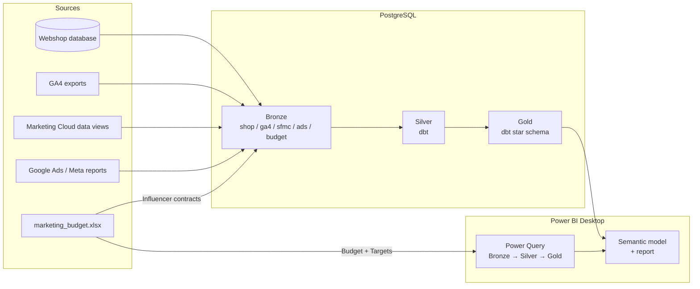

# Kalkberg documentation

This folder describes, step by step, how the Kalkberg data was turned into a Power BI report. For every step we write down **what** we did, **how** we did it and **why** we chose to do it that way. The business questions we answer are listed in [context.md](../context.md).

## Approach: the medallion architecture

We organise the data in three layers. Every layer has one clear job, so that a problem can always be traced back to the layer where it was caused.

| Layer | Job | Rule of thumb |
| --- | --- | --- |
| **Bronze** | Keep an exact copy of what the source delivered | No cleaning, no business logic. If you can't trust the source, you can at least trust that bronze shows what it sent. |
| **Silver** | Clean, standardise and connect the data | Correct types, one notation per value, duplicates removed, keys that link the sources together. |
| **Gold** | Model the data for reporting | A star schema with facts and dimensions, at the grain the report needs. |

We apply this architecture twice, with two different tools:

- **In PostgreSQL** for the webshop, GA4, Marketing Cloud, the ad platforms and the influencer contracts. Bronze is loaded with `psql`, and silver and gold are built with dbt.
- **In Power BI (Power Query)** for the marketing budget and the targets in `data/budget/marketing_budget.xlsx`.

Doing it in both places is on purpose: it shows the same way of thinking in two tools, and when each tool is the better fit. See [decision 0001](decisions/0001-medallion-in-two-tools.md).

## Steps

| # | Step | Status |
| --- | --- | --- |
| 0 | [Setup: tools and how to reproduce the project](00-setup.md) | Done |
| 1 | [Bronze: landing the raw data in PostgreSQL](01-bronze.md) | Done |
| 2 | [Profiling: what is wrong with the raw data?](02-profiling.md) | Done |
| 3 | [Silver: cleaning and connecting the data (dbt)](03-silver.md) | Done |
| 4 | Gold: the star schema (dbt) | Next |
| 5 | Connecting Power BI to the gold layer | Planned |
| 6 | The budget medallion in Power Query | Planned |
| 7 | Semantic model and DAX measures | Planned |
| 8 | The report | Planned |

## Decisions

Larger choices are recorded as short decision records in [decisions/](decisions/). Each one describes the context, the decision, and its consequences.

| # | Decision |
| --- | --- |
| [0001](decisions/0001-medallion-in-two-tools.md) | Build the medallion in PostgreSQL *and* in Power Query |
| [0002](decisions/0002-raw-schemas-are-bronze.md) | The raw schemas are the bronze layer |
| [0003](decisions/0003-influencer-contracts-in-postgres.md) | Land the influencer contracts in PostgreSQL, keep budget and targets in Power Query |
| [0004](decisions/0004-person-key.md) | One person key across shop accounts, guest orders and subscribers |

## Conventions in these documents

- Screenshots live in [img/](img/) and are named after the document they belong to (`01-...png` belongs to `01-bronze.md`). A screenshot that is still missing is marked with a placeholder that starts with **SCREENSHOT PLACEHOLDER**.
- Warnings, notes and tips use GitHub's alert syntax (`> [!NOTE]`, `> [!WARNING]`, ...), so they stand out when the docs are read on GitHub.
- Commands are written for a Windows terminal, run from the project folder unless stated otherwise.
- The project is written in English for a Belgian and Dutch audience, so numbers and dates use the Belgian format: `1.234,56` and `31/03/2026`. The same goes for the report, which uses the *English (Belgium)* locale: English labels, Belgian dates and numbers. Values quoted literally from a source or a query result (in `code` style) are shown exactly as the source wrote them, because they are evidence.
